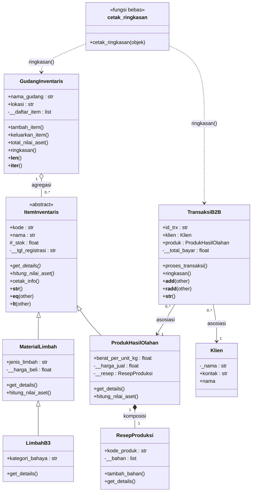

# Sistem Inventaris dan Transaksi B2B Daur Ulang Limbah

Program Python berbasis OOP (CLI) untuk perusahaan daur ulang limbah. Program mengelola **material limbah** (termasuk limbah B3) sebagai bahan baku, **produk hasil olahan** beserta resep produksinya, **gudang** yang menampung semua item, **klien**, dan **transaksi B2B** (dengan PPN 11%).

Posttest ini berfokus pada **Abstraksi** dan **Polimorfisme**.

| File | Isi |
|---|---|
| `inventaris.py` | `ItemInventaris` (abstract), `MaterialLimbah`, `LimbahB3`, `ProdukHasilOlahan`, `ResepProduksi` |
| `main.py` | `GudangInventaris`, `Klien`, `TransaksiB2B`, `Aplikasi` (menu CLI), fungsi `cetak_ringkasan` |

Menjalankan program (pilih menu **11 - Muat data contoh** dulu agar data awal terisi):

```bash
python main.py
```

---

## 1. Class Diagram dan Relasi UML



Keterangan simbol: `◁──` pewarisan, `◇──` agregasi, `◆──` komposisi, `──>` asosiasi, `..>` pemanggilan duck typing. Tanda `*` pada nama method berarti abstract.

### Asosiasi: `TransaksiB2B` → `Klien` dan `TransaksiB2B` → `ProdukHasilOlahan`
`TransaksiB2B` hanya *menggunakan* objek `Klien` dan `ProdukHasilOlahan` yang sudah ada (disimpan sebagai `self.klien` dan `self.produk`) untuk mencatat siapa membeli apa dan memotong stok produk. Tidak ada kepemilikan, klien dan produk tetap hidup tanpa transaksi, jadi relasinya asosiasi biasa.

```python
# TransaksiB2B.__init__ dan proses_transaksi
self.klien = klien_obj
self.produk = produk_obj
...
self.produk.stok_unit -= self._jumlah_unit
```

### Agregasi: `GudangInventaris` ◇— `ItemInventaris`
`GudangInventaris` menampung banyak item (`MaterialLimbah`, `LimbahB3`, `ProdukHasilOlahan`) di list `__daftar_item`. Dipilih **agregasi** karena item dibuat di luar gudang lalu dimasukkan lewat `tambah_item()`, dan setelah `keluarkan_item()` objeknya dikembalikan serta tetap ada. Item bisa hidup tanpa gudang.

```python
def tambah_item(self, item):
    self.__daftar_item.append(item)     # item dibuat di luar gudang

def keluarkan_item(self, kode):
    ...
    self.__daftar_item.remove(item)
    return item                         # objek tetap ada setelah keluar
```

### Komposisi: `ProdukHasilOlahan` ◆— `ResepProduksi`
Setiap `ProdukHasilOlahan` memiliki tepat satu `ResepProduksi` yang **dibuat di dalam konstruktornya sendiri** dan disimpan sebagai atribut private `__resep`. Dipilih **komposisi** karena resep tidak pernah dibuat tanpa produknya (memakai `kode` produk) dan tidak dibagikan ke objek lain, sehingga siklus hidupnya terikat dengan produk.

```python
# ProdukHasilOlahan.__init__
self.__resep = ResepProduksi(self.kode)
```

| | Agregasi (Gudang → Item) | Komposisi (Produk → Resep) |
|---|---|---|
| Objek bagian dibuat di | luar kelas (dikirim ke `tambah_item`) | dalam konstruktor pemilik |
| Bisa hidup tanpa pemilik? | Ya, setelah `keluarkan_item` | Tidak, terikat pada produk |
| Bisa dipakai pemilik lain? | Ya (bisa dipindah gudang) | Tidak, private |

---

## 2. Abstraksi (Abstract Base Class)

- **Abstract class:** `ItemInventaris(ABC)` di `inventaris.py`.
- **Abstract method (2):** `get_details()` dan `hitung_nilai_aset()`, keduanya diberi `@abstractmethod`.
- **Subclass yang mengimplementasikan seluruh abstract method:**
  - `MaterialLimbah` (`get_details` dan `hitung_nilai_aset`)
  - `ProdukHasilOlahan` (`get_details` dan `hitung_nilai_aset`)
  - `LimbahB3` (turunan `MaterialLimbah`, meng-override `get_details`)
- **Method konkret bersama:** `cetak_info()` di `ItemInventaris`. Satu implementasi dipakai semua subclass dan memanggil method abstract milik masing-masing objek.
- **Inheritance tetap dipakai:** `super().__init__(...)` di semua subclass, atribut unik tiap subclass (`jenis_limbah`, `kategori_bahaya`, `berat_per_unit_kg`), atribut protected `_stok`, dan atribut private `__harga_beli`, `__harga_jual`, `__resep`, `__tgl_registrasi`.

```python
class ItemInventaris(ABC):
    @abstractmethod
    def get_details(self): pass

    @abstractmethod
    def hitung_nilai_aset(self): pass

    def cetak_info(self):                       # method konkret
        print(self.get_details())
        print(f"      Nilai aset: Rp{self.hitung_nilai_aset():,.0f}")
```

### Bukti abstract class tidak bisa diinstansiasi
Menu **10 (Uji abstract class)** menjalankan `ItemInventaris(0, "XXX-000", "Item Abstrak", 1)` di dalam `try-except TypeError`:

```python
def uji_abstract(self):
    try:
        ItemInventaris(0, "XXX-000", "Item Abstrak", 1)
    except TypeError as e:
        print("  TypeError:", e)
```

Output program (menu 10):

```text
UJI ABSTRACT CLASS
------------------
  TypeError: Can't instantiate abstract class ItemInventaris without an implementation for abstract methods 'get_details', 'hitung_nilai_aset'
```

---

## 3. Polimorfisme

### a. Polimorfisme via pewarisan
`get_details()` dan `hitung_nilai_aset()` di-override dengan perilaku berbeda oleh `MaterialLimbah`, `LimbahB3`, dan `ProdukHasilOlahan` (`ProdukHasilOlahan` menampilkan status stok AMAN/STOK MENIPIS, `LimbahB3` menambah peringatan B3). Semuanya dipanggil lewat **satu loop** di `Aplikasi.lihat_gudang()` pada objek berbeda kelas, tanpa mengecek tipe:

```python
for no, item in enumerate(self.gudang, 1):
    print(f"{no}. ", end="")
    item.cetak_info()      # tiap objek menentukan perilakunya sendiri
```

Output program (menu 11 lalu menu 4):

```text
MUAT DATA CONTOH
----------------
  2 material, 2 produk, dan 2 klien dimuat.

ISI GUDANG UTAMA (BANJARMASIN)
------------------------------
1. [MAT-001] Botol Plastik PET (Plastik) | Stok: 150.0 Kg | Harga Beli: Rp3,500/Kg
      Nilai aset: Rp525,000
2. [MAT-002] Oli Bekas Industri (B3) | Stok: 80.0 Kg | Harga Beli: Rp8,000/Kg | PERINGATAN: Limbah B3 (Mudah Terbakar)!
      Nilai aset: Rp640,000
3. [PRD-001] Paving Block Plastik | Stok: 500 Unit (AMAN) | Harga Jual: Rp15,000/Unit | Berat: 2.5 Kg/Unit
      Nilai aset: Rp7,500,000
4. [PRD-002] Pelumas Daur Ulang | Stok: 120 Unit (AMAN) | Harga Jual: Rp45,000/Unit | Berat: 1.0 Kg/Unit
      Nilai aset: Rp5,400,000

Total item  : 4
Total aset  : Rp14,065,000
  Resep PRD-001: Botol Plastik PET 2.5Kg
  Resep PRD-002: Oli Bekas Industri 0.8Kg
```

Terlihat baris MAT-002 memuat peringatan B3, PRD-001 dan PRD-002 memuat status stok, dan nilai aset dihitung dengan rumus berbeda (`stok × harga_beli` vs `stok × harga_jual`).

### b. Duck typing
`GudangInventaris` dan `TransaksiB2B` **tidak berhubungan lewat pewarisan**, tetapi sama-sama punya method `ringkasan()`. Keduanya diproses satu fungsi yang sama, `cetak_ringkasan(objek)`, yang hanya mengandalkan keberadaan method `ringkasan()`:

```python
def cetak_ringkasan(objek):
    print("  *", objek.ringkasan())

cetak_ringkasan(self.gudang)          # GudangInventaris
for trx in self.daftar_transaksi:
    cetak_ringkasan(trx)              # TransaksiB2B
```

Output program (menu 7 dua kali, lalu menu 8):

```text
BUAT TRANSAKSI B2B
------------------
  1. PT Hijau Lestari (021-111222)
  2. CV Mandiri Sejahtera (0511-333444)
Pilih klien (nomor): 1
  1. PRD-001 Paving Block Plastik | stok 500 | Rp15,000
  2. PRD-002 Pelumas Daur Ulang | stok 120 | Rp45,000
Pilih produk (nomor): 1
Jumlah unit: 20
  Transaksi berhasil
   TRX: TRX-001 | Klien: PT Hijau Lestari | Produk: Paving Block Plastik | Qty: 20 Unit | Total (inc. PPN): Rp333,000

BUAT TRANSAKSI B2B
------------------
  1. PT Hijau Lestari (021-111222)
  2. CV Mandiri Sejahtera (0511-333444)
Pilih klien (nomor): 2
  1. PRD-001 Paving Block Plastik | stok 480 | Rp15,000
  2. PRD-002 Pelumas Daur Ulang | stok 120 | Rp45,000
Pilih produk (nomor): 2
Jumlah unit: 30
  Transaksi berhasil
   TRX: TRX-002 | Klien: CV Mandiri Sejahtera | Produk: Pelumas Daur Ulang | Qty: 30 Unit | Total (inc. PPN): Rp1,498,500

RINGKASAN
---------
  * Gudang Gudang Utama: 4 item, total aset Rp12,415,000
  * TRX-001: PT Hijau Lestari membeli 20 Paving Block Plastik, total Rp333,000
  * TRX-002: CV Mandiri Sejahtera membeli 30 Pelumas Daur Ulang, total Rp1,498,500

Total pendapatan (operator +): Rp1,831,500
```

Pada bagian `RINGKASAN`, baris gudang dan baris transaksi dicetak oleh fungsi yang sama.

### c. Operator overloading

| Kelas | Magic method | Dipakai untuk |
|---|---|---|
| `ItemInventaris` | `__str__` | `print(item)` menampilkan `get_details()` |
| `ItemInventaris` | `__eq__`, `__hash__` | item dianggap sama bila `kode` sama |
| `ItemInventaris` | `__lt__` | membandingkan dan `sorted(items)` berdasarkan nilai aset |
| `TransaksiB2B` | `__add__`, `__radd__` | `sum(self.daftar_transaksi)` menjumlahkan total bayar semua transaksi |
| `TransaksiB2B` | `__str__` | `print(trx)` |
| `GudangInventaris` | `__len__`, `__iter__` | `len(gudang)` dan `for item in gudang` |

Bukti `==`, `<`, dan `sorted()` (menu 9). Operator `+` terlihat pada baris "Total pendapatan (operator +)" di output duck typing di atas.

```text
BANDINGKAN DAN URUTKAN ITEM
---------------------------
  1. MAT-001 Botol Plastik PET
  2. MAT-002 Oli Bekas Industri
  3. PRD-001 Paving Block Plastik
  4. PRD-002 Pelumas Daur Ulang
Pilih item pertama (nomor): 1
  1. MAT-001 Botol Plastik PET
  2. MAT-002 Oli Bekas Industri
  3. PRD-001 Paving Block Plastik
  4. PRD-002 Pelumas Daur Ulang
Pilih item kedua (nomor): 3

  MAT-001 == PRD-001  ->  False
  MAT-001 <  PRD-001  ->  True  (nilai aset 525,000 vs 7,200,000)

Urutan nilai aset dari terkecil:
  MAT-001  Rp525,000
  MAT-002  Rp640,000
  PRD-002  Rp4,050,000
  PRD-001  Rp7,200,000
```

### d. Tanpa anti-pattern
Tidak ada rantai `if/elif` yang mengecek `type()` atau string jenis untuk membedakan perilaku objek. Perbedaan perilaku sepenuhnya lewat method yang di-override (`get_details`, `hitung_nilai_aset`). Satu-satunya percabangan `y/n` ada di menu input (`tambah_material`) untuk memilih kelas yang dibuat, bukan untuk membedakan perilaku objek yang sudah ada.

---

## 4. Nilai Plus: Penerapan SOLID

**Open/Closed Principle (OCP).** `LimbahB3` ditambahkan sebagai kelas baru yang meng-override `get_details()` dan memanggil `super().get_details()`, tanpa mengubah satu baris pun di `MaterialLimbah`. Begitu juga `GudangInventaris` dan `Aplikasi.lihat_gudang()`: jenis item baru (misalnya `ProdukSetengahJadi`) cukup mewarisi `ItemInventaris` dan langsung bisa disimpan, dicetak, dan dihitung asetnya tanpa mengubah kode gudang. Menu `Aplikasi` juga berupa daftar `(nama, fungsi)`, jadi menambah fitur cukup menambah satu entri.

**Dependency Inversion Principle (DIP).** `GudangInventaris` bergantung pada abstraksi `ItemInventaris` (hanya memakai `kode` dan `hitung_nilai_aset()`), bukan pada kelas konkret `MaterialLimbah` atau `ProdukHasilOlahan`. `total_nilai_aset()` bekerja untuk semua jenis item. Selain itu, `TransaksiB2B` menerima `klien_obj` dan `produk_obj` lewat konstruktor (dependency injection), bukan membuatnya sendiri.

**Liskov Substitution Principle (LSP).** `MaterialLimbah`, `LimbahB3`, dan `ProdukHasilOlahan` bisa dipakai di mana pun `ItemInventaris` diharapkan. Buktinya satu loop `lihat_gudang()` dan `sorted(items)` bekerja untuk ketiganya tanpa pengecualian.

Catatan: `TransaksiB2B` masih bergantung langsung pada `ProdukHasilOlahan` (memakai `stok_unit` dan `harga_jual`) karena hanya produk yang dijual, jadi DIP hanya diklaim untuk `GudangInventaris`.
